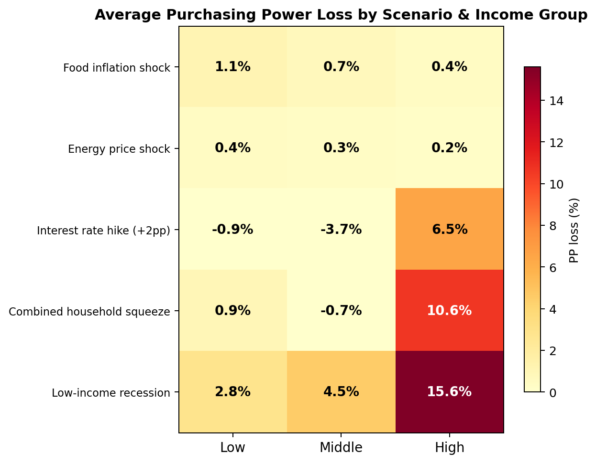
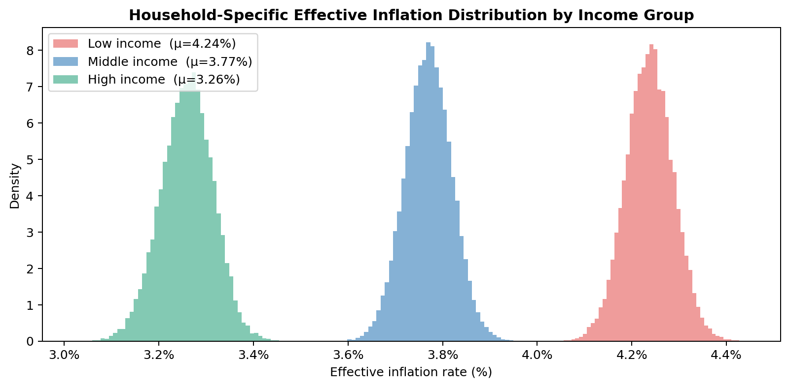
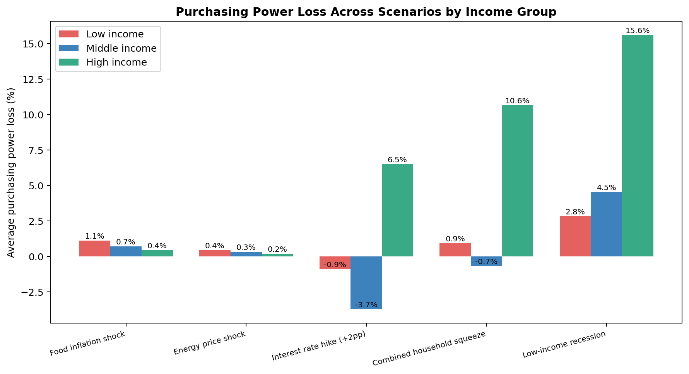
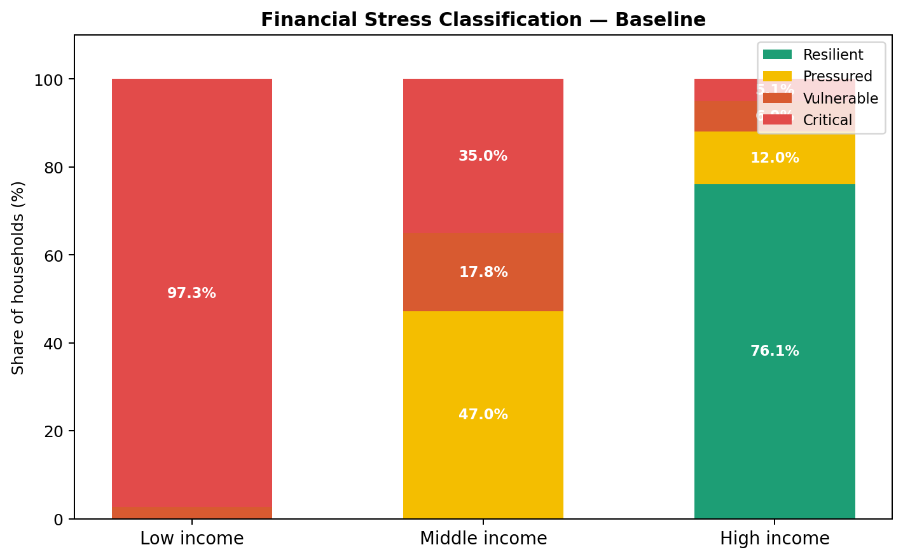
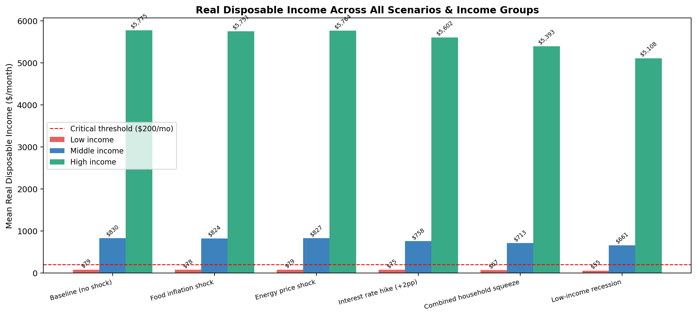

# Inflation Inequality & Debt Pressure Model

**How rising prices and debt costs hit different households differently.**

> [!NOTE]
> **The source code of this project is private.** This repository is its public showcase: the
> README, screenshots and every source file with its types and function signatures, but none of the
> code inside them. If you'd like a demo or to talk about the project, open an issue.

A Monte-Carlo simulation of how inflation, interest-rate hikes and income shocks affect low-, middle- and high-income households. It generates up to 100,000 synthetic households, each with its own income, spending mix, debts and savings. It runs them through a set of economic shocks and classifies every household from **Resilient** to **Critical**.

The model has two front ends:

- an interactive **Streamlit dashboard**, which you can calibrate to your own city, income and household
- a **terminal report** that prints summary tables and saves 15 charts to `outputs/`



---

## Why it exists

Headline inflation is an average, but households don't spend like the average. A low-income household puts roughly 29% of its budget into food and 34% into rent. A high-income household puts about 45% into discretionary goods, which usually rise in price more slowly. So the same economy produces a different *personal* inflation rate for each group. Add variable-rate debt and a thin savings buffer and the gap widens further. This model measures that gap.

## Features

### Streamlit dashboard (`app.py`)

| Tab | What it does |
|---|---|
| **📍 Local Crisis Baseline** | You enter your city, country, income (in any of 9 currencies), adults and children, and housing (rent or own, type, bedrooms, area). The whole app then recalibrates to your location: income bands, spending shares, debt assumptions and stress thresholds. |
| **📖 How It Works** | Explains each layer in plain language: households, inflation, debt, stress and scenarios. |
| **📊 Real Data Analysis** | Runs the full simulation on the location-calibrated population and shows where *you* sit compared with local households. |
| **🌍 World Comparison** | Ranks 575 cities and their countries by purchasing power, cost of essentials, salary-to-rent, mortgage affordability and overall balance, measured against your current location. Uses Numbeo data, with a panel showing how fresh each source is. |
| **📋 Data Tables** | Scenario summary tables, purchasing-power loss by group, a sample of the generated households and the active configuration. |
| **🧪 Simulation Sandbox** | Set your own shock with sliders: food, rent, energy, transport, healthcare, education, discretionary, interest rates and income. You see the effect on the whole population and on your personal budget. |

### Terminal report (`main.py --report-only`)

- Prints a full explanation of the model, then a summary table per income group for each scenario
- Saves 15 PNG charts to `outputs/`, including inflation distributions, purchasing-power-loss heatmaps, stress tiers, debt composition and real disposable income across scenarios

## How the model works

Every household goes through a six-stage pipeline for each scenario:

| Stage | Step | Formula |
|---|---|---|
| 1 | Income shock | `income × (1 + income_delta)` |
| 2 | Effective inflation | `π_h = Σ w_{h,i} · π_i` (the household's own spending weights × the inflation rate of each category) |
| 3 | Rate shock | Variable-rate debt is re-amortised at `rate + rate_delta`. Fixed-rate debt is unaffected. |
| 4 | Debt metrics | `DSR = debt / income`, `EBR = (essentials + debt) / income` |
| 5 | Purchasing power | `RDI = (income − essentials − debt) / (1 + π_h)` |
| 6 | Stress classification | Resilient → Pressured → Vulnerable → Critical |

**Stress tiers** (checked from the top down, so the first match wins):

| Tier | Condition (any of) |
|---|---|
| 🔴 Critical | DSR ≥ 50% · EBR ≥ 85% · RDI < $200/month |
| 🟠 Vulnerable | DSR ≥ 40% · EBR ≥ 75% |
| 🟡 Pressured | DSR ≥ 30% · EBR ≥ 65% |
| 🟢 Resilient | none of the above |

### Built-in scenarios

| Key | Scenario |
|---|---|
| `baseline` | Current conditions, no shocks |
| `food_shock` | Food inflation +8pp |
| `energy_shock` | Energy prices +10pp |
| `rate_hike` | +2pp on all variable-rate debt |
| `combined_squeeze` | Food +6pp, rent +4pp, energy +8pp, rates +2pp, income −3% |
| `recession` | Food +4pp, energy +5pp, rates +1.5pp, income −8% |

All baseline parameters live in [`config.py`](config.py): income groups, spending shares, category inflation rates, debt profiles, household sizes, savings buffers, thresholds and scenarios. Edit that file to change the assumptions.

## Data sources

The location features pull live data where they can:

- **Eurostat HICP** (`prc_hicp_aind`): category-level inflation for EU/EEA countries
- **Eurostat EU-SILC** (`ilc_di03`, `ilc_li01`, `ilc_li02`, `ilc_di11`): income distributions and poverty thresholds
- **U.S. Census ACS** (`B19001`, `B19013`): U.S. household income distribution
- **Numbeo**: city and country cost-of-living and quality-of-life rankings, plus real prices for your own city
- **Frankfurter API**: currency exchange rates

### How Numbeo data is used

| Data | Where it comes from |
|---|---|
| Cost-of-living, rent, groceries, restaurant and purchasing-power indices for 575 cities | Numbeo's *Cost of Living Index by City* table |
| **Your city's** rent, net salary, utilities, transport pass, mortgage rate, purchase price per m², childcare and school fees | Your city's own Numbeo page (`numbeo.com/cost-of-living/in/<City>`), in USD |
| Other cities' prices | Numbeo's per-city price tables when available. Otherwise **your city's real prices scaled by each city's Numbeo index** (rent by the rent index, salary by purchasing power × cost of living, and so on), so every city is measured relative to the place you're comparing from. If your city's page isn't available, New York's prices are used as the base, because Numbeo indices are relative to New York (= 100). |
| Quality of life, safety, healthcare, pollution | Numbeo's *Quality of Life* tables by city and country |

Every salary in the tables is labelled by its source: ✅ Numbeo price data, 📌 the April 2026 city details, or ⚠️ estimated from indices. The **📡 Data freshness** panel on the World Comparison tab shows where each table came from and when it was fetched.

**Numbeo's free page limit.** Numbeo allows free users a monthly number of page views per page type. When that budget runs out, it answers with *Access Restricted* (HTTP 429) until the date in its `Retry-After` header. The app is built to stay inside that budget:

- All requests go through [`numbeo_client.py`](numbeo_client.py), which stops asking for a page type until its `Retry-After` date. This is remembered across restarts.
- Every successful download is saved to `.cache/numbeo_cache.json` and reused for 24 hours. A normal session makes about 6 requests instead of downloading every table on every page load.
- When a page can't be fetched, the app uses the newest saved copy. That is either your local cache or the bundled snapshot in `data/numbeo_snapshot.json`: city rankings from 21 Oct 2026 and Berlin's prices from 20 Oct 2026. The built-in April 2026 data is the last resort.
- **Refresh Live Comparison** in the app forces a new download, unless Numbeo has paused access.

Numbeo data is © [Numbeo](https://www.numbeo.com) and is subject to its Terms of Use. If you need more than the free limit, Numbeo sells a premium plan and an API.

## Project structure

```
├── app.py                  # Streamlit dashboard
├── main.py                 # CLI entry point: launches the dashboard or prints the terminal report
├── config.py               # All model assumptions and scenario definitions
├── household_generator.py  # Layer 1: synthetic household generation
├── inflation_engine.py     # Layer 2: household-specific effective inflation
├── debt_engine.py          # Layer 3: rate shocks, DSR and EBR
├── purchasing_power.py     # Layer 4: real disposable income
├── metrics.py              # Layer 5: stress classification and summaries
├── scenario_runner.py      # Layer 6: runs the pipeline per scenario
├── sandbox_simulator.py    # Custom shocks and your personal impact
├── location_profile.py     # Calibrates the model to your location (Eurostat / Census)
├── inflation_fetcher.py    # Live Eurostat HICP inflation rates
├── world_comparison.py     # City and country rankings (Numbeo)
├── data_fetcher.py         # Numbeo city rankings (live, cached or embedded), FX rates
├── numbeo_client.py        # All Numbeo requests: rate-limit handling and 24h disk cache
├── dashboard.py            # Matplotlib charts used by the dashboard and the CLI
├── data/
│   └── numbeo_snapshot.json  # Bundled Numbeo data used when live pages are unavailable
└── outputs/                # Charts saved by the terminal report
```

## Sample output

| | |
|---|---|
|  |  |
|  |  |

## Limitations

- Households are synthetic. They are drawn from configured distributions, not from real microdata.
- The savings buffer is generated but does not yet feed into the stress classification.
- Live data depends on third-party sites. When a source is unavailable, the app falls back to saved or embedded data, and the Data freshness panel says so.
- Without Numbeo's per-city price tables (limited for free users), other cities' rent and salaries are estimates scaled from your own city's real prices. Only your own city uses its exact Numbeo prices. For example, anchored on Berlin, the estimate for Lisbon's salary lands within about 2% of Numbeo's own figure.
- Mortgage rates for cities other than yours fall back to a single default rate, because Numbeo publishes them only in its per-city price data.
- This is an educational and analytical tool, not financial advice.

## License

© 2026 Christo Dontchev. All rights reserved. The source code is private and is not licensed for
use, copying or distribution; see [LICENSE](LICENSE).
